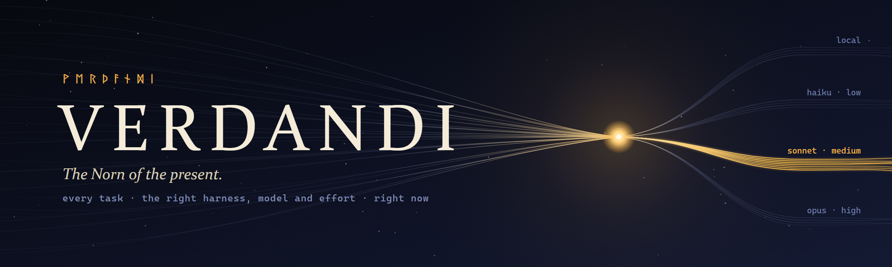

<p align="center">
  
</p>

# Verdandi ᚹ

<p align="center">
  <a href="docs/DESIGN.md"></a>
  <a href="docs/decisions"></a>
  
  
  
</p>

**A local-first workspace and personal agent platform for coding agents.** Verdandi drives *harnesses* (Claude Code first, then its own native agent loop, then others) and routes every task to the harness, provider, model and effort level that finishes it at the lowest *effective* cost. A commit message doesn't need Opus at `xhigh`, and a subtle concurrency bug shouldn't go to a small local model. Verdandi sizes each task, explains the choice in one line, and learns from how it turned out.

It also remembers across sessions, writes and improves its own skills, runs on a schedule, and can be reached from chat apps. Everything lives on your machine. Nothing leaves it except calls to the providers you've configured.

<table>
<tr><td><b>A task router, not a model picker</b></td><td>For every task, Verdandi picks a <i>route</i>: harness, provider, model, effort, interaction mode and subagent profiles. It weighs subscription quota, API credits and local compute as costs, switches only at task boundaries so prompt caches survive, and escalates mid-task when a verifier says the cheap route isn't enough. Every decision gets a readable reason, and overriding it takes one click.</td></tr>
<tr><td><b>Built on the harnesses you already use</b></td><td>Claude Code runs through your installed and logged-in CLI, on your subscription, with its subagents, skills, hooks, MCP and plan mode intact. The native harness calls model APIs directly: Anthropic, OpenAI, OpenRouter, Google, and Ollama for local models. Codex, OpenCode and ACP agents come later.</td></tr>
<tr><td><b>A fast workspace</b></td><td>Threads, streaming, diffs, approvals, plan mode, worktrees, checkpoints you can revert to, and a real terminal, in a web UI built to replace the terminal for daily agent work. No constantly repainting animations, and no spinners that lie about progress.</td></tr>
<tr><td><b>An agent that learns</b></td><td>Memory across sessions, session search on SQLite FTS5, and skills that are proposed from repeated work, curated and improved over time. Skills learned on a strong model run on a cheaper one. Every task records its route, outcome and trajectory in a format you can train on.</td></tr>
<tr><td><b>Small judgments without LLM calls</b></td><td>A decision layer answers typed questions (what kind of task is this, is this command safe, what's worth remembering, which context to keep) with calibrated probabilities from fast decision models instead of full LLM calls.</td></tr>
<tr><td><b>Always on, reachable anywhere</b></td><td>Scheduled jobs run unattended in worktrees within a budget. Start, steer and approve tasks from Telegram, Discord or Slack. Keep separate <code>work</code> and <code>personal</code> profiles.</td></tr>
<tr><td><b>Event-sourced and inspectable</b></td><td>Every command is saved as an event before anything happens, and the UI is a view of that log. Routing decisions, overrides and spend can all be inspected afterwards.</td></tr>
</table>

---

## Status

Verdandi is early. The design is in [`docs/DESIGN.md`](docs/DESIGN.md), the M0 spike results are recorded as [ADRs](docs/decisions), and the M1 core loop is being built: `verdandid`, an event store, the Claude Code harness, a terminal chat and a web UI. Parts of M2 and M3 are in too, such as the router, worktrees, checkpoints, verifiers and memory. Nothing is released yet.

| Milestone | Scope |
| --- | --- |
| **M0 · Spike** | Agent SDK under Bun on Windows, effort and model switching, hooks, `bun:sqlite` FTS5, Effect 4, PTY host. Done, see [ADRs](docs/decisions). |
| **M1 · Core loop** | verdandid and the web UI on Claude Code: threads, streaming, approvals, plan mode, diffs, resume, the usage ledger, trajectory recording. *In progress.* |
| **M2 · Router v1** | Rules classifier, policy files, pins, switch-cost gate, decision records, plan→execute split, budget modes, spend dashboard. *In progress.* |
| **M3 · Memory, skills, safe autonomy** | Worktrees, checkpoints, verifiers and escalation, memory, session search, the skill lifecycle, injection scanning. *In progress.* |
| **M4 · Native harness and providers** | Verdandi's own agent loop; Anthropic, OpenAI-compatible and Gemini providers; routing and hand-off across harnesses. |
| **M5 · Always-on** | Scheduler, messaging gateway, webhooks, profiles, desktop app, approvals from your phone. |
| **M6 · Learn and reach** | Learned router, batch runs, execution backends, plugins, more harnesses, OpenAI-compatible API, ACP and MCP servers. |

---

## Quick start (from source)

You need [Bun](https://bun.sh) 1.4.2 or newer and, for the Claude Code harness, a logged-in [Claude Code](https://claude.com/claude-code) install.

```bash
git clone https://github.com/Brattlof/verdandi.git
cd verdandi
bun install
```

Start the server against a throwaway dev home, then open the web UI or chat from a second terminal:

```bash
bun run dev                                          # verdandid, state in ./.verdandi-dev
bun run verdandi open --home ./.verdandi-dev         # the web UI in your browser
bun run verdandi chat --home ./.verdandi-dev         # chat with the thread for this folder
bun run verdandi chat --home ./.verdandi-dev --model opus --effort high
bun run verdandi doctor --home ./.verdandi-dev       # check Bun, Claude Code, git, the database and the server
```

Without `--home`, Verdandi uses your real profile in `~/.verdandi/profiles/default`.

---

## How routing looks

| You ask | Verdandi routes it to |
| --- | --- |
| "Rename `userId` to `accountId` across the app" | Claude Code, Sonnet at `low`. Search subagents run on Haiku. |
| "Why does the websocket drop after ~30 min?" | Claude Code, Opus at `high`. |
| "Add team invites with email verification" | Plan with Opus at `high`, build with Sonnet at `medium` once you approve, review with Opus at `medium`. |
| "Write a commit message" | The native harness on a local model, at no cost. Haiku if there is no local model. |
| Subscription quota nearly used up at 4 pm | The router spends quota more carefully and moves chores to API credits or local models, if your policy allows. |
| You pin Opus on a thread | The pin always wins, and the override is recorded as feedback for the router. |

Policy lives in plain files (`<repo>/.verdandi/routing.yaml`), so you can read, diff and version how your tasks get routed. See [DESIGN.md §8](docs/DESIGN.md#8-task-based-routing).

---

## Surfaces

| Surface | What it's for | Available |
| --- | --- | --- |
| **CLI** (`verdandi`) | `start`, `open`, `chat`, `doctor`, `costs`, `search`, `routing replay` and `batch` today; headless `run "<task>"` later. | Now |
| **Web UI** | The main workspace. | M1 |
| **Desktop app** | Tray, notifications, auto-update, manages the server. | M5 |
| **Messaging gateway** | Start, steer and approve tasks from chat apps. | M5 |
| **OpenAI-compatible API** | `model: "verdandi/auto"`, so any tool can use Verdandi as a routed model. | M6 |
| **ACP and MCP servers** | Use the native agent from ACP editors, and share memory, skills and sessions with other MCP clients. | M6 |

Clients talk to `verdandid` over a WebSocket on `127.0.0.1`, with a token the server writes to `server.json` in the profile's home each time it starts.

---

## Documentation

| Document | What's covered |
| --- | --- |
| [Design](docs/DESIGN.md) | Scope, architecture, routing, harnesses, learning, security, milestones. The source of truth. |
| [Decisions](docs/decisions) | Architecture decision records, including the M0 spike results. |
| [AGENTS.md](AGENTS.md) | How we build Verdandi: principles, invariants, code shape, verification. Read it before contributing, whether you're a person or an agent. |
| [Agent skills](.agents/README.md) | The shared skills every coding agent in this repo reads. |

---

## Contributing

Verdandi is built largely by coding agents, directed by people. [AGENTS.md](AGENTS.md) is the canonical guide for both. In short:

- Read the section of `docs/DESIGN.md` that covers your change before you make it.
- Fight scope creep: extend existing code before adding a feature, and add a feature before adding a dependency.
- Prove each change with the smallest check (`bun test <files>`, `bun run typecheck`). CI runs the full suite on Windows, macOS and Linux.
- Commit messages are one imperative line, e.g. `Add decision layer`.

---

## The name

In Norse myth, the three Norns weave the threads of fate at the roots of Yggdrasil. **Verðandi** (ᚹᛖᚱᚦᚨᚾᛞᛁ) is the Norn of the present: what is happening now. Verdandi works the same way. Everything happens in threads, and for each one it decides, right now, which model and how much effort the next task gets. Not too big, not too small.
