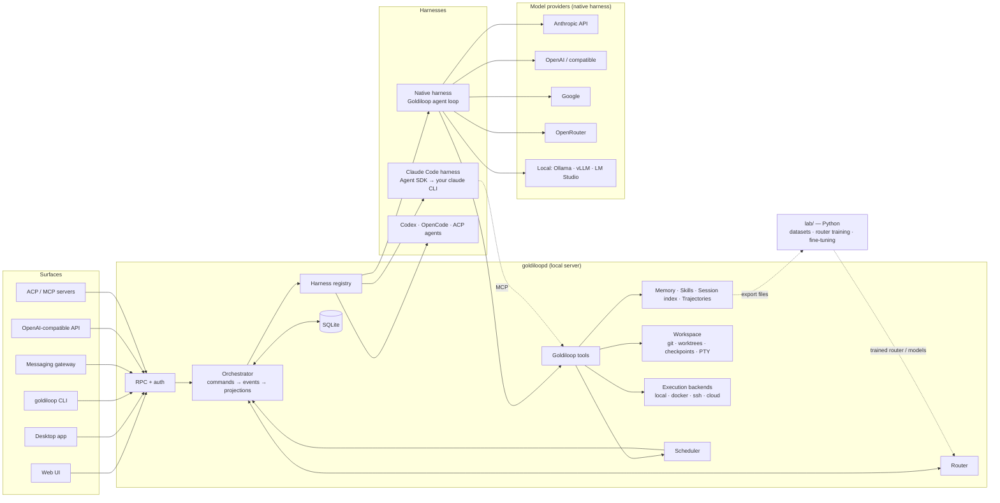
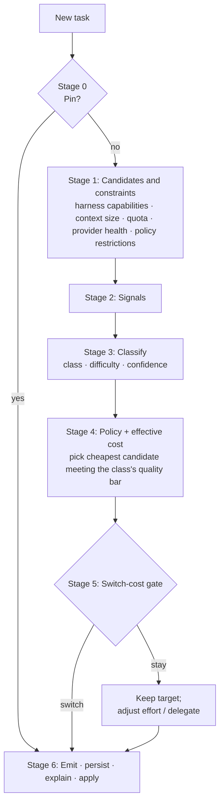

# Goldiloop — Design Document

| | |
|---|---|
| **Status** | Draft v0.2 — for review |
| **Owner** | @Brattlof |
| **Last updated** | 2026-09-29 |
| **Repo** | [Brattlof/goldiloop](https://github.com/Brattlof/goldiloop) (private) |

> **Changes since v0.1**
> - Goldiloop now has its **own agent loop** (the *native harness*) alongside Claude Code, and supports many model providers.
> - Routing now covers **harness × provider × model × effort**, across subscription, metered and local access.
> - The design now includes the full set of agent capabilities: learning, memory, skills, trajectories, scheduler, messaging gateway, execution backends, profiles, plugins, and more interfaces (API, ACP, MCP).
> - The tech stack is final: Node, pnpm, Effect and Electron, plus a Python `lab/`.
> - The milestones have been re-planned.

---

## 1. Summary

Goldiloop is a local-first workspace and personal agent platform for AI coding and automation. It combines four things:

1. **A fast workspace GUI.** It covers threads, diffs, approvals, worktrees, checkpoints and a terminal.
2. **An agent that runs all the time and learns.** It keeps memory across sessions and writes and improves its own skills. It records its trajectories, meaning full session histories with their outcomes, as data it can learn from. It also runs scheduled jobs and can be reached from chat apps.
3. **Many harnesses and providers.** A *harness* is whatever runs the agent loop:
   - **Claude Code**, driven through your installed and logged-in CLI, which uses your subscription;
   - **Goldiloop's own native agent**, which calls model APIs directly: Anthropic API credits, OpenAI, OpenRouter, Google, local models through Ollama, and more;
   - other agent CLIs later.
4. **A task router.** This is the defining feature. For every task it picks the harness, provider, model and effort level that will finish the task at the lowest *effective* cost. It shows why, and it learns from the outcome.

Goldiloop starts with Claude Code, because that's what the owner uses every day. Every other part is designed from the start to work with any harness and any provider.

> **The name.** Goldilocks rejected the porridge that was too hot and the one that was too cold, and ate the one that was just right. Goldiloop gives every task the model that's just right for it: not too big, not too small. "Loop" refers to the agent loop.

---

## 2. Problem

- **One model for everything wastes tokens and quota.** A commit message doesn't need Opus at `xhigh`, and a subtle concurrency bug shouldn't be tried on a small local model.
- **Every way of reaching a model has a different kind of cost.** A subscription has usage limits. API credits cost money. Local models are free but weaker. No tool today weighs all three when choosing.
- **Switching naively is expensive.** Prompt caches and thinking blocks belong to one model. A switch mid-conversation bills the entire context again.
- **Agent CLIs are built for the terminal.** Running sessions in parallel, reviewing diffs and approving actions there is clumsy.
- **Agents forget, and they don't improve.** Every session starts from zero. A procedure you've taught once has to be taught again. Nothing learns from what worked.
- **Agents are stuck at the desk.** You can't start, steer or approve work from your phone, or have it run on a schedule.

---

## 3. Goals and non-goals

### Goals

| # | Goal | How we'll know |
|---|---|---|
| G1 | **Task-based routing** that lowers effective cost without hurting results | On our own eval set, cost per completed task is at least 30% lower than "always Opus at default effort", with no drop in success rate. |
| G2 | **A great GUI for agent sessions** | It can replace the terminal for daily Claude Code work. |
| G3 | **Transparent, overridable routing** | Every decision has a one-line reason, and overriding takes one click. Fewer than 15% of tasks are overridden once the router is tuned. |
| G4 | **An agent that learns** | Memory and skills build up over time. Skills learned on a strong model run on a cheaper one. Recorded trajectories are good enough to train on. |
| G5 | **Many harnesses and providers** | Adding a harness or provider needs no change to the router or the orchestration core. |
| G6 | **Always on, reachable anywhere** | Scheduled jobs run without you. Tasks can be started and approved from a chat app. |
| G7 | **Local-first and private** | State lives in local SQLite. Nothing leaves the machine except calls to the providers you've configured. |

### Non-goals for now

- Hosting a cloud or multi-tenant SaaS.
- Intercepting another harness's API traffic, for example with an `ANTHROPIC_BASE_URL` proxy in front of Claude Code.
- Reading, storing or brokering Claude Code's own subscription credentials.
- Team collaboration, or a native mobile app. The web UI reached over Tailscale covers mobile.

---

## 4. Users and scenarios

**Primary user:** a developer who runs agents across many repos on Windows, macOS or Linux. They have a Claude subscription, possibly API credits with one or more providers, and possibly local models.

| # | Scenario | What Goldiloop does |
|---|---|---|
| S1 | "Rename `userId` to `accountId` across the app" | Claude Code, Sonnet at `low`. Search subagents run on Haiku. |
| S2 | "Why does the websocket drop after ~30 min?" | Claude Code, Opus at `high`. |
| S3 | "Add team invites with email verification" | Plan with Opus at `high`. Once you approve the plan, build with Sonnet at `medium`. Review with Opus at `medium`. |
| S4 | "Write a commit message" / "title this thread" | Native harness with a local model, at no cost. If no local model is configured, Haiku. |
| S5 | Subscription quota almost used up at 4 pm | The router gets stricter about what's worth spending quota on. Chores move to API credits or local models, if your policy allows. |
| S6 | Nightly "update deps, fix breakages" | A scheduled task runs in a worktree, within a budget. The result goes to Telegram, and you approve the PR from your phone. |
| S7 | You fix the same kind of CI failure for the third time | Goldiloop proposes a skill with a routing hint. Next time the fix runs on a cheaper route. |
| S8 | You pin Opus on a thread | The pin always wins. The override is recorded as feedback for the router. |

---

## 5. Principles

1. **Size every task correctly.** Aim for the cheapest route that completes the task, measured as cost per completed task. Quota and local compute count as costs too.
2. **Switch at boundaries.** Model, provider or harness changes happen at task boundaries.
3. **Don't break the cache.** Within a session, the system prompt and the tool list never change. Anything that changes between turns goes into the next user turn instead.
4. **Explain every decision.** Each routing decision is stored and can be inspected, and comes with a readable reason.
5. **The user always wins, and every override is data.**
6. **Complexity lives in the adapters; the core stays pure.** Each harness, provider and platform is an adapter behind a small interface. Orchestration and routing are deterministic.
7. **Save intent before acting.** Every command is saved as an event before anything else happens. The UI is a view of that event log.
8. **Use a harness's built-in features.** With Claude Code, use its subagents, skills, hooks, MCP and plan mode. With the native harness, Goldiloop provides those features itself.
9. **Learn from everything.** Every task records its route, outcome and trajectory in a format that can be trained on.
10. **Keep the core small: the Footprint Ladder.** Before adding anything to the core, try these, cheapest first:
    1. extend existing code;
    2. a CLI command plus a skill;
    3. a tool that is only enabled under certain conditions;
    4. a plugin;
    5. an MCP server.

    A new core feature is the last resort.

---

## 6. System overview



| Component | Responsibility |
|---|---|
| **goldiloopd** | One long-running local process that owns all state and every session. All the surfaces are thin clients. |
| **Orchestrator** | Turns commands into events and events into projections. Side effects happen only in *reactors*. |
| **Router** | A pure function from `(signals, policy, thread state, catalog, budget)` to a `RouteDecision`. |
| **Harness registry** | Holds one adapter per harness: Claude Code, native, and later others. Each declares its capabilities. |
| **Native harness** | Goldiloop's own agent loop. It handles tool use, subagents, context management and prompt caching across providers. |
| **Model providers** | Adapters for each API format, the model catalog, credentials, fallbacks and health checks. Used by the native harness and for auxiliary tasks. |
| **Goldiloop tools** | Memory, skills, session search, scheduling, messaging and so on. Each tool is implemented **once**. The native harness calls it directly; other harnesses reach it over MCP. |
| **Learning** | Memory, session search, the skill lifecycle, background review, and recording trajectories. |
| **Execution backends** | Where the native harness runs commands: locally, in Docker, over SSH, or in a cloud sandbox. |
| **Scheduler** | Runs tasks on a schedule, without you present. |
| **Surfaces** | Web and desktop GUI, CLI, messaging gateway, OpenAI-compatible API, and ACP and MCP servers. |
| **lab/** | Python, offline. Builds datasets, trains the router, and optionally fine-tunes models. It exchanges data with the app **only through files**. |

---

## 7. Domain model

```
Profile ─┬─ Project ─┬─ Thread ─┬─ Task ─┬─ Turn ─── Item (message | tool call | approval | plan | …)
         │           │          │        ├─ RouteDecision (1)
         │           │          │        └─ TaskOutcome (1)   → Trajectory (export)
         │           │          └─ HarnessSession (resumable, 0..n)
         │           └─ RoutingPolicy (project layer)
         ├─ Memory · Skills · Schedules · Channels (gateway bindings)
         └─ Credentials refs · Provider config · Budget
UsageRecord ── per turn → rolled up per task / thread / project / day
```

- **Profile:** a completely separate Goldiloop home, e.g. `work` vs `personal`. Each has its own database, memory, skills, credentials and gateway bindings.
- **Project:** a local repo, or a non-code workspace such as the default "Chat" project that gateway conversations go into.
- **Thread:** a lasting conversation. It can have a worktree, and a channel binding (e.g. a Telegram chat).
- **Task:** the unit of routing. A task is a continuous run of turns under **one** `RouteDecision`. A new task starts when:
  - a thread starts,
  - the phase changes (plan → implement → verify),
  - you override the route,
  - the router escalates or de-escalates,
  - the work changes sharply,
  - or the thread switches harness or provider.
- **HarnessSession:** the harness's own session handle, e.g. a Claude Code session ID or a native session ID. A thread may use several over its life.

**Why routing works per task:** per turn loses the cache, and per thread can't adapt as the work changes (§8.2).

---

## 8. Task-based routing

### 8.1 The decision

```ts
type Effort = "low" | "medium" | "high" | "xhigh" | "max";
type Access = "subscription" | "metered" | "local";

interface RouteTarget {
  harness: HarnessId;      // "claude-code" | "native" | "codex" | …
  provider: ProviderId;    // "claude-subscription" | "anthropic-api" | "openrouter" | "ollama" | …
  model: string;           // "sonnet" | "claude-sonnet-5-5" | "qwen3-coder" | …
  access: Access;
}

interface RouteDecision {
  taskId: TaskId;
  taskClass: TaskClass;            // §8.4
  difficulty: number;              // 0..1
  confidence: number;              // 0..1
  target: RouteTarget;
  effort: Effort;
  interaction: "default" | "plan";
  subagents: SubagentProfile[];    // each with its own RouteTarget + effort
  escalation: EscalationPolicy;    // §8.7
  limits?: { maxTurns?: number; maxCost?: number };
  estimate: { tokens: number; cost: EffectiveCost; switchCost: EffectiveCost };
  reason: string;                  // one sentence, shown in the UI
  trace: RuleTrace[];
  source: "pin" | "policy" | "escalation" | "deescalation" | "memory" | "learned";
}
```

### 8.2 Levers, from least to most disruptive

| # | Lever | Effect on the cache | Mechanism |
|---|---|---|---|
| 1 | **Subagent routing:** send exploration, search and review to cheaper or stronger subagents | Main thread's cache untouched | Claude Code: `agents` with a `model` per agent. Native: `delegate_task`, routed per child. |
| 2 | **Effort:** same model, more or less thinking | Small, or none (verify for each harness) | Effort setting for the harness |
| 3 | **Plan / execute split** | Switch happens at plan approval, a natural boundary | Plan mode, then a model switch |
| 4 | **Switch the main model** mid-thread | Full cache miss | Only if it passes the switch-cost gate |
| 5 | **New session with a handoff**, possibly on another **harness or provider** | Starts a new, small context | Fresh session, seeded with a structured handoff summary |

**Why route per task and not per turn.** Earlier projects point the same way:
- Hermes Agent shipped per-turn routing of short, simple messages to a cheap model, then removed it in April 2026. It had been opt-in and off by default, and it conflicts with that project's rule that the prompt stays cached for the whole conversation.
- Cursor's router and GitHub Copilot's Auto mode both include the cost of breaking the cache when they decide. They switch only at cache boundaries, or when the task has changed a lot.

**Handoff format for lever 5.** The summary always has the same sections: *Goal, Constraints, Progress, Decisions, Files touched, Open issues, Next steps.* A cheap auxiliary model writes it (§9.7). The old transcript stays searchable through `session_search`.

**Baseline to beat:** often the best option is the strongest model at lower effort, because a single model keeps a single cache. The router must beat this baseline (§8.10).

### 8.3 Effective cost across access modes

Each access mode has a different kind of cost. The router turns them all into one `EffectiveCost`, so they can be compared:

| Access | What it really costs | How the router prices it |
|---|---|---|
| **metered** (API credits) | Dollars | List prices from the catalog, with cache reads and writes priced separately |
| **subscription** (Claude Code CLI) | Usage limits | **Priced by how much quota is left.** When there's plenty left, the price is low and fixed. As the limit gets close, the price rises smoothly, so remaining quota goes to the tasks that need it most. |
| **local** (Ollama, etc.) | Time and hardware; lower quality | Close to zero, plus a latency cost and a quality penalty. Both are learned per task class from outcomes. |

The budget mode (Thrifty, Balanced or Max) sets how these weigh against each other. The policy can also forbid cheaper fallbacks for specific work, e.g. "never send billing code to local models".

### 8.4 The pipeline



- **Stage 0 · Pins.** Your explicit choice always wins. Sources: a thread pin, the picker, or `@opus` / `@local` / `@native` typed in the composer.
- **Stage 1 · Candidates.** Start from every target that is configured. Remove the ones that:
  - **lack a needed capability**, such as tools, vision or a 1M context (e.g. Haiku 4.5's 200K window is too small);
  - **are out of quota or unhealthy**, meaning rate-limited or down, according to provider health (§9.5);
  - **are forbidden by policy**, e.g. local models for security reviews.
- **Stage 2 · Signals.** These are cheap and extracted locally:
  - *Text:* intent words, stack traces, file references, and phrases like "think hard" or "quick".
  - *Workspace:* repo size, languages, whether a verifier exists.
  - *Thread:* earlier classes and outcomes, the current target, **how much context is already cached**.
  - *Mode:* Ask / Plan / Build.
  - *Routing memory:* how similar tasks in this project went before (§8.8).
- **Stage 3 · Classify.** The classifier is pluggable:
  - `rules`: free, deterministic, with golden tests. This is the default.
  - `local`: a small model through Ollama, e.g. Arch-Router-1.5B.
  - `api`: Haiku or another cheap metered model, with structured output.
  - `learned`: a model trained in `lab/` and served through ONNX or Ollama.

  If confidence is below a threshold, the router uses the budget mode's safe default instead of guessing.
- **Stage 4 · Policy and cost.** The policy sets a **quality bar** for each class, meaning which targets and efforts are acceptable. Among the candidates that meet it, the router picks the lowest effective cost.
- **Stage 5 · Switch-cost gate.** Suppose the thread already has a warm session and the policy picks a different target. The router switches only when either:
  1. the policy needs a *more capable* target, or
  2. the expected savings are greater than the switch cost (re-reading the cached context, plus the handoff).

  Otherwise it stays put and saves another way: lower effort, or cheaper subagents.
- **Stage 6 · Emit.** Save the decision, show its reason, and apply it.

Stages 1–5 are pure and fast, so the composer shows a **live routing preview while you type**.

### 8.5 Task taxonomy (v1)

| Class | Examples | Balanced route (Claude-only setup) |
|---|---|---|
| `ask.search` | "Where is the auth middleware?" | Haiku · low |
| `ask.explain` | "What does this reducer do?" | Sonnet · low |
| `chore.git` | Commit message, PR description | Haiku · low (local model if one is configured) |
| `docs.write` | README, changelog | Sonnet · low |
| `code.edit.mechanical` | Renames, moves, simple CRUD | Sonnet · low (+ Haiku explorers) |
| `code.edit.local` | Bug fix or small feature in 1–3 files | Sonnet · medium |
| `test.write` | Adding tests | Sonnet · medium |
| `code.feature` | Multi-file feature | Plan: Opus · high → Execute: Sonnet · medium |
| `code.refactor.large` | Cross-cutting refactor | Plan: Opus · high → Execute: Sonnet · high |
| `debug.investigate` | Unknown root cause | Opus · high |
| `review` | Code or security review | Opus · medium |
| `design.architecture` | Designs, trade-offs | Opus · high (Fable in Max mode) |
| `chat.general` | Gateway chit-chat, quick questions | Cheapest acceptable (local or Haiku) |
| `aux.*` | Titles, commit messages, handoffs, compression, vision, background review, judging whether a command is safe, classification | Set per aux task (§9.7) |

**Budget modes:**
- **Thrifty** moves routes one step down and makes local models acceptable more often.
- **Balanced** uses the table as shown.
- **Max** moves routes one step up, and makes Fable eligible for design and debugging work.

### 8.6 Catalog and policy as data

**Catalog.** A bundled data file, refreshed from provider model APIs. It records, per model:
- which harness can run it,
- which provider serves it,
- its context window,
- prices (input, output, cache read, cache write),
- capabilities (tools, vision, thinking, effort levels),
- its access mode.

Current Claude entries:

| Tier | Model | Via Claude Code (subscription) | Via Anthropic API ($/MTok in · out) | Context | Default effort |
|---|---|---|---|---|---|
| S | Claude Haiku 4.5 | `haiku` | 1 · 5 | 200K | n/a |
| M | Claude Sonnet 5.5 | `sonnet` | 2 · 10 | 1M | high |
| L | Claude Opus 5.5 | `opus` | 4 · 20 | 1M | **medium** |
| XL | Claude Fable 5.1 | `fable` | 10 · 50 | 1M | high |

Defaults differ between models, so **the router always sets effort explicitly**.

**Policy.** Policies are layered, and each layer overrides the one before:
1. built-in defaults
2. profile policy
3. project policy (`.goldiloop/routing.yaml`)
4. thread pin

```yaml
# <repo>/.goldiloop/routing.yaml
mode: balanced                       # thrifty | balanced | max
classifier: rules                    # rules | local | api | learned
minConfidence: 0.6

targets:                             # named targets used below
  cc-haiku:   { harness: claude-code, provider: claude-subscription, model: haiku }
  cc-sonnet:  { harness: claude-code, provider: claude-subscription, model: sonnet }
  cc-opus:    { harness: claude-code, provider: claude-subscription, model: opus }
  api-sonnet: { harness: native, provider: anthropic-api, model: claude-sonnet-5-5 }
  local-code: { harness: native, provider: ollama, model: qwen3-coder }

routes:
  chore.git:          { prefer: [local-code, cc-haiku], effort: low }
  debug.investigate:  { prefer: [cc-opus], effort: high, thrifty: { prefer: [cc-sonnet], effort: high } }
  code.feature:
    plan:    { prefer: [cc-opus], effort: high }
    execute: { prefer: [cc-sonnet, api-sonnet], effort: medium }
    subagents:
      explorer: { prefer: [cc-haiku], effort: low }
      reviewer: { prefer: [cc-opus], effort: medium }

quota:
  subscription: { spillTo: [api-sonnet, local-code], spillWhenRemainingBelow: 0.15 }

escalation:
  verifiers: ["pnpm test", "pnpm typecheck"]
  ladder: [effort, model, ask]
  maxAutoEscalations: 1

restrictions:
  - match: "packages/billing/**"
    forbid: [local]                   # never route billing code to local models
    minTier: L
```

### 8.7 Escalation and de-escalation while a task runs

**Escalation triggers**, strongest signal first:
1. A verifier (tests, typecheck, build) fails after the agent says it's done.
2. The same error repeats.
3. You reject a diff, revert, or push back.
4. The agent calls `report_blocked`.

Research shows that turn count alone is barely better than chance at predicting failure, so it is used **only as a budget guard**.

**The escalation ladder:**
1. raise effort one step,
2. then move to a stronger target, which starts a new task with a handoff,
3. then ask you.

By default, at most one step happens per task without asking you.

**De-escalation** happens after you approve a plan, and after the verifiers pass when only mechanical work is left.

### 8.8 Learning loop for routing

Every task produces a `TaskOutcome`:

```ts
interface TaskOutcome {
  taskId: TaskId;
  status: "completed" | "abandoned" | "reverted" | "escalated" | "failed";
  implicitSatisfaction: number;   // moved on / committed (+) vs. correction follow-ups (−)
  userOverride?: { from: RouteTarget & { effort: Effort }; to: RouteTarget & { effort: Effort } };
  verifierRuns: { command: string; passed: boolean }[];
  escalations: number;
  usage: UsageBreakdown;          // tokens, cache read/write, cost, quota units, by model
  wallMs: number;
  rating?: 1 | -1;
}
```

These outcomes are used at three levels:
1. **Routing memory per project** (M2), e.g. "debug tasks on Sonnet escalated 7 times out of 10, so start on Opus".
2. **Offline replay:** re-run the router over saved tasks to see how a policy change would have routed them.
3. **A learned router** trained in `lab/` (M6). It is adopted only if it beats `rules` on the eval set.

### 8.9 Budgets

- **Metered:** real dollars. Daily and monthly caps per profile, and per project.
- **Subscription:** quota tracking (if the CLI reports rate-limit state; verify in M0), quota-based pricing, and moving work to other targets when quota runs low (§8.3).
- **Per task:** `maxTurns` and `maxCost`.
- **The spend dashboard** shows real spend, quota use, and savings vs. always-Opus. The savings figure is labelled as an estimate.

### 8.10 Evaluation

- **Eval set:** 30–100 real tasks, each with a verifier. Each is replayed in a temporary worktree from a pinned commit (`goldiloop batch`, §14.6).
- **Baselines:**
  - (a) always Opus at default effort,
  - (b) always Sonnet at `high`,
  - (c) the strongest model at lower effort,
  - (d) a random router spending the same amount.
- **Metrics:** success rate, cost per completed task, time, override and escalation rates, and the cost–quality curve with its APGR.
- **Race mode:** run the same task on two routes in parallel worktrees. This improves quality directly, and every race also produces a labelled preference pair (§14.6).

---

## 9. Harnesses and model providers

### 9.1 Concepts

- **Harness:** runs the agent loop, meaning it plans, calls tools and edits files.
  - *External* harnesses bring their own loop and authentication: Claude Code, and later Codex, OpenCode and ACP agents.
  - The *native* harness is Goldiloop's own loop.
- **Model provider:** where inference happens. The native harness and auxiliary tasks call providers directly. External harnesses reach their models themselves.
- **Access mode:** `subscription`, `metered` or `local` (§8.3).

Claude is reachable in **two** ways:
1. **Claude Code harness:** your subscription, through your installed CLI.
2. **Native harness:** Anthropic API credits.

The router can choose between them. For example, it can move work to API credits when subscription quota runs low.

### 9.2 Harness contract

```ts
interface HarnessAdapter {
  readonly id: HarnessId;
  readonly capabilities: {
    inSessionModelSwitch: boolean;
    inSessionEffortSwitch: boolean;
    planMode: boolean;
    subagentRouting: boolean;
    rollback: boolean;
    mcpClient: boolean;             // can reach Goldiloop tools over MCP
    costReporting: "usd" | "tokens" | "none";
  };
  targets(): Promise<RouteTarget[]>;          // what this harness can run
  startSession(input: StartSessionInput): Promise<SessionHandle>;
  sendTurn(s: SessionHandle, turn: TurnInput): Promise<void>;
  steer(s: SessionHandle, message: string): Promise<void>;   // guidance while the agent is working
  applyRoute(s: SessionHandle, d: RouteDecision): Promise<ApplyResult>;
  interrupt(s: SessionHandle): Promise<void>;
  respond(s: SessionHandle, requestId: string, r: ApprovalResponse | UserInputResponse): Promise<void>;
  rollback?(s: SessionHandle, toTurn: number): Promise<void>;
  stop(s: SessionHandle): Promise<void>;
  events(s: SessionHandle): AsyncIterable<HarnessEvent>;     // normalized
}
```

`ApplyResult` reports whether the route was applied in the running session, by restarting and resuming, or as a new session with a handoff. That lets the switch-cost gate price the switch correctly.

### 9.3 Claude Code harness

- **Transport:** the Claude Agent SDK for TypeScript, in streaming-input mode, with `pathToClaudeCodeExecutable` pointing at **your installed `claude`**. Your authentication, settings, plugins, CLAUDE.md files and skills all apply unchanged. Raw stream-JSON is kept as a fallback.
- **Routing controls:**
  - model via `setModel()`;
  - plan mode and permissions via `setPermissionMode()`;
  - effort through the SDK option, settings or env var (decided in M0);
  - subagents via `agents`, each with its own `model`.
- **Approvals:** `canUseTool` becomes an approval event. `AskUserQuestion` becomes a user-input request.
- **Sessions:** resume, fork, and resuming at a given message. Transcripts stay where Claude Code keeps them; Goldiloop stores pointers and a normalized copy for trajectories.
- **Goldiloop tools reach Claude Code over MCP**, through an MCP server running inside goldiloopd (§9.6). This gives Claude Code sessions Goldiloop's memory, session search, scheduling, messaging and escalation.
- **Hooks:**
  - `PostToolUse` checks verifier results.
  - `Stop` and `SubagentStop` mark the end of a task and its outcome.
- **Telemetry:** usage per message, and `modelUsage` from the result, go into the usage ledger.

### 9.4 Native harness (Goldiloop's own agent loop)

- **The loop:**
  1. Call the model.
  2. Run the requested tools. Tools that are safe to run together run in parallel; interactive ones run one at a time. Results go back in the original order.
  3. Repeat until done, the iteration budget runs out, or you interrupt.
- **Steering:** while the agent is working, you can send guidance. It's delivered after the next tool result, which is a safe point.
- **Rules it never breaks:**
  - the system prompt and tool list stay byte-for-byte identical for the whole session;
  - user and assistant turns strictly alternate;
  - thinking blocks go back unchanged to the model that produced them.
- **Prompt assembly** is fixed for each session:
  - persona (`persona.md`),
  - harness instructions,
  - context files (`AGENTS.md`, `CLAUDE.md`, `.cursorrules`, in priority order, each scanned for prompt injection),
  - the skills index,
  - the memory snapshot.

  Anything that changes between turns goes into user turns.
- **Tools:** the full Goldiloop tool set (§9.6), plus MCP servers you configure. When there are many MCP tools, **tool search** replaces their full schemas with a small search tool, so they don't fill the context.
- **Subagents:** `delegate_task` starts child sessions with fresh context and gets back a summary. **Each child is routed as its own task**, e.g. a frontier model plans and cheap models do the work. Concurrency and nesting depth are limited.
- **Context management:** see §16.
- **Mixture-of-agents (optional, M6):** several reference models give advice, and one aggregator acts on it. It's offered as a route type for hard design questions.

### 9.5 Model provider layer

- **API formats**, built on the official SDKs:
  1. **Anthropic Messages** (`@anthropic-ai/sdk`);
  2. **OpenAI Responses and Chat Completions** (`openai`). This also covers every OpenAI-compatible endpoint: OpenRouter, Ollama, vLLM, LM Studio, DeepSeek, xAI, Groq, Together and others.
  3. **Google Gemini** (`@google/genai`).

  Bedrock, Vertex and Foundry come later, through the same SDKs' platform clients.
- **Internal message format:** normalized content blocks (text, image, tool use, tool result, thinking). Blocks specific to one provider are carried along unchanged, so they can be sent back exactly.
- **Why our own thin layer instead of a generic multi-provider SDK:** cost control depends on provider-specific features, such as cache breakpoints, effort, passing thinking blocks back, cache diagnostics and task budgets. Generic abstractions tend to flatten these away. To be confirmed by an ADR in M4.
- **Credentials:** environment variables, the OS keychain, or a `keyCommand` (e.g. a password-manager CLI). Multiple keys per provider rotate when one hits a rate limit.
- **Resilience:** a fallback chain for rate limits, server errors and auth errors, with backoff until the limit resets. Per-provider health feeds router Stage 1.

### 9.6 Goldiloop tools: implemented once, available everywhere

| Tool | Native harness | Claude Code and others (via MCP) |
|---|---|---|
| `memory_save`, `memory_search` | ✔ | ✔ |
| `session_search` | ✔ | ✔ |
| `skills_list`, `skill_view`, `skill_manage` | ✔ | ✔ (Claude Code also loads skills natively) |
| `cronjob` (create, list, pause jobs) | ✔ | ✔ |
| `send_message` (to gateway channels) | ✔ | ✔ |
| `report_blocked` | ✔ | ✔ |
| `todo`, `clarify` | ✔ | — (Claude Code has its own) |
| `delegate_task` | ✔ | — (Claude Code has Task subagents) |
| `terminal`, file read/write/patch, search | ✔ (through execution backends) | — (Claude Code has its own) |
| `web_search`, `web_fetch` | ✔ (provider server tools, or Goldiloop's own) | — |
| `vision` (describe an image through an auxiliary model) | ✔ | — |
| `execute_code` (a sandboxed script that calls tools through RPC) | ✔ (M6) | — |
| `browser` | ✔ (M6, Playwright) | — |

### 9.7 Auxiliary tasks

Some jobs are small, but a model still has to do them:
- titles and commit messages,
- handoff summaries,
- context compression,
- vision descriptions,
- background review,
- judging whether a command is safe,
- routing classification.

These are **routed tasks** (`aux.*` classes) with their own policy entries, so they automatically use the cheapest acceptable target: usually a local model, then Haiku.

### 9.8 More harnesses (M6)

Codex through its JSON-RPC `app-server`, OpenCode, and ACP-speaking agents. Every harness that supports MCP automatically gets the Goldiloop tools.

---

## 10. Orchestration and persistence

- **Event-sourced core:**
  1. A command goes to a pure decider.
  2. The decider produces events, which update the projections in **one SQLite transaction**.
  3. Reactors then run the side effects.

  A command is acknowledged once its intent is saved. Command receipts make retries safe.
- **Schema evolution:** events are append-only and must stay readable forever. They're versioned, and old versions are converted to the current shape as they're read.
- **Tables:**

  | Group | Tables |
  |---|---|
  | Log and receipts | `events`, `command_receipts` |
  | Projections | `projects`, `threads`, `tasks`, `turns`, `items`, `checkpoints` |
  | Routing | `route_decisions`, `task_outcomes`, `routing_memory` |
  | Usage and providers | `usage_ledger`, `provider_health` |
  | Learning | `memories` (+ FTS5), `session_index` (FTS5, including a trigram index for Chinese, Japanese and Korean text and for substring search), `skills`, `skill_runs`, `trajectories` |
  | Automation | `schedules`, `schedule_runs`, `channels`, `channel_bindings` |

- **Location:** one database per profile, at `~/.goldiloop/profiles/<name>/goldiloop.db`, in WAL mode, with numbered migrations.

---

## 11. Surfaces

| Surface | Purpose | Milestone |
|---|---|---|
| **Web UI** | The primary workspace | M1 |
| **CLI** (`goldiloop`) | `start`, `open`, `doctor`, `run "<task>"` (headless), `chat` (simple terminal chat), `batch` (eval and trajectory runs) | M1 → M6 |
| **Desktop app** (Electron) | Tray, notifications, auto-update, manages the server process | M5 |
| **Messaging gateway** | Start, steer and approve tasks from chat apps (§15) | M5 |
| **OpenAI-compatible API** | `model: "goldiloop/auto"`, so any tool can use Goldiloop as a routed model | M6 |
| **ACP server** | Use the native agent from editors that support ACP | M6 |
| **MCP server** | Expose memory, skills and sessions to other MCP clients | M3 (for Claude Code), then public in M6 |

**Protocol:** a WebSocket on `127.0.0.1`, with a per-profile token. Typed RPC contracts shared by server and clients:
- `command.dispatch`
- `project.subscribe`, `thread.subscribe` (a snapshot, then a stream of events)
- `diff.*`, `terminal.*`
- `routing.simulate`, `routing.explain`
- `usage.query`

---

## 12. User experience

- **Layout:**
  - sidebar: profiles, projects and threads, with live status and cost;
  - center: the conversation;
  - right panel, switchable: diff, terminal, routing trace, or memory and skills.
- **Composer:**
  - a live **routing preview chip** ("Sonnet · medium via Claude Code — local bug fix, tests present");
  - Ask / Plan / Build toggle;
  - budget-mode switch;
  - `@target` pins;
  - attachments;
  - **steer** (send while the agent is working).
- **Route chip on each task:** shows the reason, the trace and the alternatives, with a one-click override.
- **Plan cards:** approve, edit or reject a plan. Approving shows the route change.
- **Dashboards:**
  - spend and quota;
  - cost per task class;
  - how usage is split across targets;
  - escalation and override rates;
  - estimated savings.
- **Memory and Skills panels:** view, edit and delete memories. Review proposed skills and memories. Skill usage and staleness.
- **Automations panel:** schedules, run history, and gateway channels with their bindings.
- **Performance rules:** no constant animations, small WebSocket messages, virtualized lists.

---

## 13. Workspaces and execution

- **Worktrees (per thread, optional):** `git worktree add` under `~/.goldiloop/worktrees/<repo>/<branch>`. Setup scripts run when a worktree is created, and a cleanup policy removes old ones.
- **Checkpoints:** at the end of each turn, the tree is saved to hidden refs `refs/goldiloop/checkpoints/<thread>/<turn>`, using a temporary index so your branch and staging area are never touched.
- **Revert:** the conversation only, or the conversation and the files.
- **Terminal:** the server owns the PTYs (`node-pty`), which the UI renders with xterm.js.
- **Execution backends** decide where the native harness runs commands, set per project:
  - `local` (the default),
  - `docker` (a per-project container),
  - `ssh` (a remote host),
  - cloud sandboxes as plugins (M6).

  Claude Code runs locally at first. Running it inside a container or on a remote host comes later.
- **Windows is first-class.** ConPTY, paths, and worktree paths with spaces are all covered by tests.

---

## 14. Learning: memory, skills and trajectories

### 14.1 Three kinds of learning

| Kind | What it is | Where it runs |
|---|---|---|
| **1. Memory and skills** | Memory, session search, writing and improving skills, background review | Inside goldiloopd, all the time (TypeScript) |
| **2. Router learning** | Routing memory, then a learned classifier | Statistics in goldiloopd; training in `lab/` |
| **3. Model training** | Fine-tuning or RL on trajectories | `lab/`, offline, often on a GPU machine |

### 14.2 Memory

- **Built-in stores:** `user` (preferences, conventions) and `project` (architecture facts, gotchas, commands). Each entry records its source (thread and turn) and a last-confirmed date.
- **Fixed-size snapshot:** a capped snapshot is added to the prompt at session start. The caps are per scope (about 2K characters for project memory and 1.5K for user memory). It doesn't change for the rest of the session, which protects the cache. Anything written during the session shows up in the next session's snapshot.
- **Lookups:** `memory_search` results are added to the current user turn, never to the system prompt.
- **Memory is capped on purpose.** When the cap is reached, a save fails and asks the agent to **consolidate**: merge, rewrite or drop older entries.
- **Periodic nudges:** every *N* turns the agent is prompted to consider saving memory.
- **Background review** (§14.5) proposes memories after tasks.
- **Scanning:** every entry is scanned before it's saved, for secrets, prompt injection and data exfiltration. You can require approval for saves. Everything can be seen and edited in the Memory panel.
- **External memory providers (plugins, M6):** a `MemoryProvider` interface with hooks for:
  - adding a block to the system prompt,
  - prefetching,
  - syncing each turn,
  - session end,
  - before compression,
  - when memory is written,
  - when work is delegated.

  This makes room for user modelling (e.g. Honcho) and vector memories (e.g. mem0). One external provider can be active, always *in addition to* the built-in stores.
- **Relation to CLAUDE.md:** Goldiloop never silently edits CLAUDE.md or AGENTS.md. It proposes changes as diffs for you to approve.

### 14.3 Session search

Every turn from every harness goes into an FTS5 index, so past solutions can be recalled across harnesses and projects. Search results are snippets with a few messages of context either side; no LLM call is needed.

### 14.4 Skills

- **Format:** the Agent Skills `SKILL.md` format (the agentskills.io standard, also used by Claude Code). A skill folder can include `scripts/`, `references/` and `templates/`.
- **Locations:**
  - `~/.goldiloop/profiles/<p>/skills/` (yours);
  - `<repo>/.claude/skills/` (project; Claude Code loads these natively);
  - read-only extra folders (e.g. `~/.agents/skills`).
- **Progressive disclosure:** a compact skills index sits in the prompt. `skill_view(name)` loads the whole skill, and `skill_view(name, path)` loads a file inside it.
- **Lifecycle:**
  1. **Propose.** The agent calls `skill_manage` (create, patch, edit, delete, write file). It is nudged every *N* tool iterations. Background review can also propose skills, and `/learn` builds a skill from docs or URLs.
  2. **Review.** Nothing is added without your approval by default. A linter gives advice.
  3. **Use.** Claude Code picks skills up natively. The native harness uses the skills index plus `skill_view`.
  4. **Improve.** When a run of a skill fails, a *patch* is proposed; small patches are preferred over full rewrites.
  5. **Curate.** A skill Goldiloop created moves from *active* to *stale* after 14 days unused, and to *archived* after 30. Archived skills are hidden but never deleted. Merging near-duplicate skills is opt-in.
- **Routing link: learn with Opus, repeat with Haiku.** A skill's frontmatter can carry a routing hint, e.g. `goldiloop: { route: { prefer: [cc-haiku], effort: low } }`. The hint is checked against outcome tracking like any other route.
- **Skills hub (M6):** install skills from a curated index, Git repos, or other people's shared folders. Each installed skill is pinned to a version.

### 14.5 Background review

After a task finishes, a background job reviews it on a cheap auxiliary target, working from a short **digest** rather than the full transcript. It proposes:
- memories to save,
- skills to create or patch,
- routing notes.

With the native harness, the review can be a *fork* of the session that keeps the same tool list, so it reuses the session's prompt cache.

### 14.6 Trajectories and training data

- **Recorded from the first milestone (M1):** every task is saved as a normalized **trajectory**, in any harness. A trajectory contains:
  - the messages, tool calls and tool results;
  - the route that was used;
  - the outcome and verifier results;
  - usage.
- **Export** (`packages/trajectories`):
  - **message JSONL** (OpenAI-style, with tool calls), for fine-tuning;
  - **preference pairs** from race mode and overrides (the route that won vs. the one that lost), for DPO-style training;
  - **routing datasets** (signals → outcome per target), for training the router;
  - **Parquet**, for analysis.

  Secrets are masked on export, and you can exclude projects.
- **Batch runner:** `goldiloop batch tasks.yaml --routes a,b,c` runs task lists headless across routes in temporary worktrees. It's used for evals, router training data, and generating trajectories on purpose.
- **RL environments (M6+):** the native harness can be wrapped as an environment for RL frameworks from `lab/`.

### 14.7 The lab (Python, offline)

- Lives in `lab/`: a Python project managed with uv, using ruff, ty and pytest.
- **Jobs:**
  - build datasets from exports;
  - train the router;
  - analyse evals;
  - optionally fine-tune *local* models.
- **Talks to the app only through files.** Exports go into the lab. Trained artifacts come back out: ONNX classifiers, or models served through Ollama.
- **Never loaded by goldiloopd,** so the running app stays pure TypeScript.

### 14.8 Terms caution

Anthropic's terms restrict using Claude's outputs to build or train models that compete with Anthropic.
- **Probably fine:** training a *router* on your own routing decisions and outcomes.
- **Probably off-limits:** fine-tuning a local coding model on Claude trajectories, which is distillation. Check the current terms for your plan before doing this.

Trajectories from open or local models don't have this restriction. The exporter records the provider of every turn, so datasets can be filtered by where their data came from.

---

## 15. Always-on: scheduler, gateway, profiles

- **Scheduler:**
  - **When:** schedules can be a duration ("in 2h"), plain language ("every weekday at 7"), a cron expression, or a one-off time.
  - **What each job can have:**
    - skills to load,
    - a route override,
    - a script to run first,
    - `contextFrom` to chain in earlier job outputs,
    - a delivery target: a channel, a thread, or a notification.
  - **Unattended runs:**
    - run in worktrees,
    - use a restricted permission profile,
    - have a hard budget,
    - are stopped by a watchdog after a period with no activity,
    - **propose** memories for review instead of saving them.
- **Messaging gateway:**
  - One gateway process inside goldiloopd, with a `PlatformAdapter` for each platform.
  - **Platforms:** Telegram, Discord and Slack first. Then WhatsApp, Signal, Matrix and email as plugins.
  - Each chat is **bound to a thread**. Approvals appear as buttons.
  - Only users on each channel's allowlist can use it.
  - Connections are outbound only, so no ports need opening.
  - Webhooks for inbound triggers, e.g. CI failed → start a fix task.
- **Profiles:** completely separate homes (`work`, `personal`), each with its own database, credentials, memory, skills and channels. Switch in the UI, or with `--profile` on the CLI.
- **Remote access:** the web UI over Tailscale. Never exposed publicly by default.

---

## 16. Context management (native harness)

Claude Code manages its own context. The native harness has a pluggable `ContextEngine`, whose default is a compressor:

1. **Trigger:** compression starts at a set fraction of the context window (a default around 50%, lower for large windows), and again as a safety measure at around 85%.
2. **Prune first, without an LLM call:** trim old tool outputs. Oversized tool results are written to disk, with a pointer left in their place.
3. **Pick the head and tail to keep,** within a token budget, never splitting a tool call from its result.
4. **Summarize the middle** with the auxiliary compression target, using the handoff sections (§8.2). The summary is updated on each later compression.
5. **Save memory first** (a background review flush), then compress. **Compression is the only allowed cache break.**

---

## 17. Security and privacy

- **Network:** goldiloopd listens on `127.0.0.1` only, and requires a token for each profile. Remote access is opt-in, through Tailscale.
- **Claude Code credentials are never touched.** The harness drives your own logged-in CLI.
  - Anthropic's Agent SDK docs say third-party developers may not offer claude.ai login or rate limits in their products without approval.
  - For personal use, this is you using your own CLI.
  - **If Goldiloop is ever distributed**, check this policy again. The native harness with API keys would be the supported path.
- **Provider API keys** (native harness) are stored in the OS keychain or fetched through a `keyCommand`, never in plain-text config. They're masked in logs, trajectories and exports.
- **Permissions:**

  | Mode | Behaviour |
  |---|---|
  | **Ask** (default) | Ask before actions that aren't pre-approved |
  | **Auto-edits** | File edits happen without asking |
  | **Auto** | A classifier decides what's allowed |
  | **Full access** | Everything allowed. Must be chosen explicitly. |

  Each harness maps these modes to its own settings. Scheduled and gateway tasks have their own restricted profiles.
- **Smart approvals (native harness):** an auxiliary model rates a command's risk, so safe commands don't need an approval prompt. Anything destructive or irreversible is never auto-approved.
- **Prompt-injection defence:**
  - context files, memory entries and skill files are scanned before use;
  - tool outputs are marked as untrusted data;
  - gateway messages from users not on the allowlist are ignored.
- **Plugins run inside goldiloopd with full trust.** They must be installed explicitly and pinned to a version, and each one is listed with the permissions it has.
- **Supply chain:**
  - every dependency pinned to an exact version;
  - pnpm `minimumReleaseAge`;
  - OSV scanning;
  - lockfile-diff review in CI;
  - Python in `lab/` pinned through `uv.lock`.

---

## 18. Extensibility

- **Plugin kinds:**
  - harness,
  - model provider,
  - gateway platform,
  - memory provider,
  - tool,
  - execution backend,
  - skill source,
  - context engine.
- **Packaging:** an npm package or a local folder, with a `goldiloop-plugin.json` manifest. Loaded inside goldiloopd, and only when explicitly installed.
- **First-party plugins** live in `plugins/` in the repo, as proof that the interfaces work.
- **Footprint Ladder** (principle 10): a new capability starts as a skill or plugin, and only moves into the core when it has to.

---

## 19. Tech stack

| Area | Choice | Why |
|---|---|---|
| Language | TypeScript, strict mode, modern ES modules only | The Agent SDK is TypeScript, types are shared between server and UI, and the leading coding agents are TypeScript |
| Runtime | **Node 24 LTS**, then 26 LTS once released (Oct 2026) | `node-pty`, Electron's built-in Node, the SDK's test matrix, Windows robustness, and running `.ts` directly |
| Type checking | TypeScript 6; code kept compatible with TypeScript 7, and switch when 7 is stable | The native compiler gives much faster type checks |
| Monorepo | pnpm workspaces + version catalogs + Turborepo | pnpm's strictness enforces package boundaries; Turborepo caches builds |
| Server core | **Effect 4** (Schema, RPC over WebSocket, SQL, Stream). Confirm in M0 whether 4 is stable enough, else use 3.x. | Cancellation, cleanup and streaming are Goldiloop's hardest problems, and Effect is designed for them. Effect Schema converts old stored events to the current shape. |
| Router | Plain pure TypeScript | Easy to reason about; runs in the browser for the live preview |
| Model SDKs | `@anthropic-ai/sdk`, `openai`, `@google/genai` | Official SDKs, with full access to cost features |
| Agent SDK | `@anthropic-ai/claude-agent-sdk`, exact version pinned | Claude Code harness |
| Database | SQLite in WAL mode via `node:sqlite` (**check FTS5 support in M0**, else `better-sqlite3`) | Local, and no native addon for Electron |
| Terminal | `node-pty` + xterm.js (WebGL) | The same pair VS Code uses |
| Git | The `git` command line, through a typed wrapper | Worktrees and low-level checkpoint commands |
| Credentials | OS keychain (`@napi-rs/keyring`) + `keyCommand` | No plain-text keys |
| Web UI | React 19 + React Compiler, Vite, TanStack Router + TanStack Virtual, Zustand | Type-safe routes, virtualized long threads |
| UI kit | Tailwind 4, shadcn/ui, Streamdown, Shiki, `@pierre/diffs`, Tiptap | Each is built for its job |
| Desktop | **Electron** + electron-builder, with auto-update | Same Chromium on every OS. The server is Node already. VS Code, Cursor, T3 Code and Hermes all ship on it. |
| Gateway | Official or leading SDK for each platform, as plugins | — |
| Local models | Ollama (and any OpenAI-compatible local server) | Free auxiliary and classifier work, and a local agent option |
| Tests | Vitest (with Effect's test helpers), Playwright, golden tests for the router, install and update end-to-end tests on all three OSes | Covers everything from the router's rules to the installer |
| Lint and format | Biome | One fast tool for both |
| Release | tsdown (server bundle + npm `goldiloop`), Vite (web), electron-builder (desktop), Changesets | — |
| CI | GitHub Actions on Windows, macOS and Ubuntu, plus supply-chain jobs | — |
| **lab/** | Python 3.13+, uv, ruff, ty, pytest; PyTorch, TRL and scikit-learn as needed; ONNX export | ML tooling lives here, outside the app |

---

## 20. Repository layout

```
goldiloop/
├─ apps/
│  ├─ server/                    # goldiloopd + `goldiloop` CLI
│  │  └─ src/
│  │     ├─ bin.ts · main.ts      # CLI entry · service wiring (Layer composition)
│  │     ├─ config/ · http/ · rpc/
│  │     ├─ orchestration/        # Engine · decider/ · projector/ · reactors/
│  │     ├─ routing/              # signal gathering, decision persistence
│  │     ├─ harnesses/            # registry, capability detection
│  │     ├─ workspace/            # git, worktrees, checkpoints, diff, terminal
│  │     ├─ scheduler/
│  │     ├─ gateway/              # gateway core; platforms come from plugins
│  │     ├─ surfaces/             # openai-compatible API, ACP server, MCP server
│  │     └─ persistence/          # sqlite + migrations
│  ├─ web/                       # React UI (features/: threads, composer, routing,
│  │                             #   approvals, diff, terminal, usage, memory,
│  │                             #   skills, automations, settings)
│  └─ desktop/                   # Electron: main, preload, server manager, tray, updater
├─ packages/
│  ├─ contracts/                 # schemas: ids, commands, events, harness events,
│  │                             #   routing, catalog, rpc
│  ├─ router/                    # PURE routing engine (server + browser)
│  ├─ harness-claude-code/       # Agent SDK adapter
│  ├─ harness-native/            # Goldiloop agent loop, prompt assembly, context engine
│  ├─ models/                    # provider adapters, catalog, credentials, fallbacks
│  ├─ tools/                     # Goldiloop tools (native + MCP exposure)
│  ├─ memory/                    # memory stores, snapshot, scanners, session index,
│  │                             #   MemoryProvider interface
│  ├─ skills/                    # skill store, skill_manage, curator, hub client
│  ├─ trajectories/              # recording format, exporters, batch runner core
│  ├─ exec/                      # execution backends: local, docker, ssh
│  ├─ client/                    # shared client runtime (web + desktop)
│  └─ testkit/                   # FAKE harness + fake provider, fixtures, helpers
├─ plugins/                      # first-party: platform-telegram, platform-discord,
│                                #   platform-slack, memory-*, exec-*
├─ policies/                     # default routing policy + model catalog (data)
├─ evals/                        # eval task sets + harness configs
├─ lab/                          # Python (uv): datasets/, router/, finetune/, notebooks/
├─ scripts/
├─ docs/
│  ├─ DESIGN.md
│  ├─ decisions/                 # ADRs
│  └─ internals/
├─ AGENTS.md · CLAUDE.md (→ @AGENTS.md)
└─ package.json · pnpm-workspace.yaml · turbo.json · biome.json · tsconfig.base.json
```

**Dependency rules:**
- `contracts` depends on nothing.
- `router` depends only on `contracts`, and never imports I/O code.
- Harness, model, memory, skills, tools and trajectories packages depend on `contracts` and `shared` helpers.
- `apps/server` depends on everything.
- `web` never imports from `server`.
- `lab/` never imports TypeScript code. It reads exported files only.

pnpm's strict mode enforces these rules at the package level.

**Packages are created when their milestone starts,** not all up front.

---

## 21. Milestones

| Milestone | Scope | Exit criteria |
|---|---|---|
| **M0 · Spike** (1–2 weeks) | Agent SDK on Node and Windows; effort and model switching; the `agents` option; hooks; the in-process MCP server; `node:sqlite` with FTS5; Effect 4 RC; `node-pty` | Every item in Appendix D answered and written up as ADRs |
| **M1 · Core loop** | goldiloopd + web UI on the Claude Code harness: threads, streaming, approvals, plan mode, diffs, resume, steer; event store; usage ledger; **trajectory recording**; fake harness for tests | You do a full day's work in Goldiloop |
| **M2 · Router v1** | `rules` classifier, policy files, pins, switch-cost gate, decision records and explanations, plan→execute split, subagent routing, budget modes, routing memory, spend dashboard | At least 30% lower cost per completed task than always-Opus, with no drop in success rate |
| **M3 · Memory, skills, safe autonomy** | Worktrees, checkpoints and revert, terminal, verifiers and escalation; memory with fixed-size snapshots, scanners and panel; session search; skill lifecycle + curator; background review; Goldiloop tools over MCP to Claude Code | Skills are created and reused; escalation fixes more than half of first-attempt failures |
| **M4 · Native harness and providers** | Agent loop, prompt assembly, context engine, subagents; Anthropic API, OpenAI-compatible (OpenRouter, Ollama…) and Gemini providers; credentials, fallbacks, health; auxiliary tasks routed; routing across harnesses; quota-based pricing and moving work to other targets | Chores run on local or cheap targets automatically; a thread can hand off between Claude Code and native |
| **M5 · Always-on** | Scheduler, gateway (Telegram, Discord, Slack), webhooks, profiles, desktop app, smart approvals, remote access | Nightly jobs run unattended within budget; tasks are approved from your phone |
| **M6 · Learn and reach** | `lab/` (datasets, router training), batch runner, race mode, learned classifier; execution backends (Docker, SSH, cloud); plugins + skills hub; external memory providers; more harnesses (Codex, OpenCode, ACP); OpenAI-compatible API, ACP and MCP servers; `execute_code`, `browser`, mixture-of-agents | The learned router beats `rules` on APGR (or is dropped); at least one plugin of each major kind works |

---

## 22. Risks

| Risk | Mitigation |
|---|---|
| **Scope:** the plan is Hermes-sized, and nothing ships | Strict milestone order. Each milestone is useful on its own. Footprint Ladder. |
| Subscription and third-party policy | Personal use of your own CLI. The native harness with API keys is the path for distribution. |
| Anthropic terms on training | Record provenance for every turn; the terms check in §14.8 |
| Harness and provider APIs change fast | Pinned versions, contract tests, capability detection, fallbacks |
| Cache effects cancel out the routing savings | Switch-cost gate. Prefer effort and subagents. Measure baseline (c) early. |
| Misrouting hurts trust | Conservative defaults, confidence threshold, one-click override, escalation, override rate as a KPI |
| The native harness is weaker than Claude Code at coding | Route coding to Claude Code by default. Native handles chores, chat, automation and non-Claude models. Measure before changing this. |
| Effect 4 RC or `node:sqlite` turn out not to be ready | Settle both in M0: fall back to Effect 3 and `better-sqlite3` |
| A malicious plugin or dependency | Explicit installs, pinned versions, supply-chain CI, scanners |
| Prompt injection through gateway messages, memory or skills | Allowlists, scanning, untrusted-data marking, approval gates |

---

## 23. Open questions (owner decisions)

1. **Distribution:** stay personal, or share or open-source it someday? This decides how much work goes into the API-key path early.
2. **Effect 4 RC vs. Effect 3 stable:** decided in M0.
3. **Default permission posture:** Ask (recommended) or Auto-edits?
4. **Fable:** allow in Max mode only (recommended)?
5. **First gateway platform:** Telegram (recommended: simplest bot API, good inline buttons) or Discord?
6. **Local models:** which local coding and chat models to target first, and on what hardware?
7. **Moving to credits when quota runs low:** on by default, or ask each time (recommended: ask the first time, then remember)?
8. **Terminal UI:** is `goldiloop chat` enough, or do you want a full terminal UI later?

---

## Appendix A — Prior art

| Area | Project | What we take from it |
|---|---|---|
| Agent GUIs | T3 Code | Event-sourced orchestration; harness adapters with capability flags; per-turn git checkpoints; approval UX |
| Personal agents | Hermes Agent | Its full feature set; see Appendix B |
| Routers | [RouteLLM](https://github.com/lm-sys/RouteLLM) | Threshold-calibrated strong/weak routing; APGR evaluation |
| | [Arch-Router](https://huggingface.co/katanemo/Arch-Router-1.5B) | Routing policies written in plain language; fast local router |
| | [claude-code-router](https://github.com/musistudio/claude-code-router) | Routing on request shape (background, thinking, long context) with no classifier |
| | [Cursor Router](https://cursor.com/blog/how-cursor-router-works), [Copilot Auto](https://docs.github.com/en/copilot/concepts/models/auto-model-selection) | Complexity scoring; switching only at cache boundaries; learning from implicit satisfaction |
| | [FrugalGPT](https://arxiv.org/abs/2305.05176) | Cascade with escalation when a scorer judges the answer too weak |
| | [Advisor strategy](https://claude.com/blog/the-advisor-strategy), `opusplan` | Planning with a big model and executing with a small one |
| Evaluation | [RouterBench](https://arxiv.org/abs/2403.12031) | Cost–quality curves; offline router scoring |

## Appendix B — Hermes capability map

Everything that makes Hermes Agent good, and where it lives in Goldiloop.

| Hermes capability | Goldiloop equivalent | § | Milestone |
|---|---|---|---|
| Own agent loop: parallel tools, interrupts, `/steer`, iteration budgets | Native harness | 9.4 | M4 |
| ~40 model providers, 3 API formats | Model provider layer: Anthropic, OpenAI-compatible, Gemini, and more as plugins | 9.5 | M4 → M6 |
| Fallback providers, credential pools, key commands | Resilience + credentials | 9.5 | M4 |
| Auxiliary models per task | Routed `aux.*` tasks | 9.7 | M4 |
| *(Hermes reaches Claude through API credits)* | **Both** API credits and your Claude Code subscription through the CLI | 9.1 | M1 / M4 |
| Fixed-size memory files, frozen snapshot, consolidation, nudges | Memory | 14.2 | M3 |
| Scanning memory for injection and exfiltration | Scanners | 14.2, 17 | M3 |
| External memory providers (Honcho, mem0, …) | `MemoryProvider` plugins | 14.2 | M6 |
| Session store with FTS5 search (+ CJK) | Session index with a trigram index | 14.3 | M3 |
| Skills: SKILL.md, progressive disclosure, `skill_manage`, nudges, `/learn` | Skills | 14.4 | M3 |
| Skill curator (active → stale → archived) | Curate step | 14.4 | M3 |
| Skills Hub | Skills hub | 14.4 | M6 |
| Background review on a forked, cache-sharing agent | Background review | 14.5 | M3 |
| Delegation: fresh-context children, "frontier planner, cheap workers" | `delegate_task`, with **each child routed** | 9.4 | M4 |
| `execute_code` (programmatic tool calling) | `execute_code` | 9.6 | M6 |
| Terminal backends: local, Docker, SSH, Modal, Daytona, … | Execution backends | 13 | M4 → M6 |
| Messaging gateway (~20 platforms) + webhooks + API server | Gateway + webhooks + OpenAI-compatible API | 11, 15 | M5 → M6 |
| Cron: plain-language schedules, per-job skills and model, pre-run scripts, chaining, delivery, watchdog | Scheduler | 15 | M5 |
| Context compression: pruning, structured summary, save memory first | Context engine | 16 | M4 |
| Tool search for many MCP tools | Tool search | 9.4 | M4 |
| Rule that the prompt stays cached | Principle 3; native harness rules | 5, 9.4 | M1 |
| Context files (AGENTS.md, CLAUDE.md, …) + persona (SOUL.md) | Prompt assembly + `persona.md` | 9.4 | M4 |
| Smart approvals through an auxiliary model | Smart approvals | 17 | M5 |
| Profiles (isolated homes) | Profiles | 15 | M5 |
| Plugins + the Footprint Ladder | Extensibility | 18 | M6 |
| ACP adapter, MCP server | ACP and MCP surfaces | 11 | M6 |
| Mixture-of-agents | MoA route type | 9.4 | M6 |
| Batch runner, trajectory compression, RL environments | Batch runner, trajectory exporters, `lab/` | 14.6, 14.7 | M1 (recording) → M6 |
| Exact pins, supply-chain CI | Supply chain | 17 | M0 |
| Terminal UI | `goldiloop chat` (a full terminal UI is an open question) | 11 | M1 |
| **Not in Hermes** | Task routing across harnesses and access modes, workspace GUI, worktrees, checkpoints, race mode, learned routing | 8, 12, 13 | M1 → M6 |

## Appendix C — Glossary

- **Harness:** whatever runs the agent loop. Claude Code, the native harness, and so on.
- **Provider:** where inference runs (Anthropic API, OpenRouter, Ollama, …).
- **Access mode:** `subscription`, `metered` or `local`.
- **Target:** a harness, provider, model and access mode together.
- **Route:** a target plus effort, interaction mode and subagent profiles.
- **Task:** a run of turns under one route. The unit of routing.
- **Pin:** a route you set explicitly. It always wins.
- **Verifier:** a command whose exit code tells whether the work is correct.
- **Switch cost:** the cost of re-reading the cached context, plus a handoff, when the target changes.
- **Trajectory:** a recorded task (messages, tools, route, outcome), exportable for training.
- **APGR:** Average Performance Gap Recovered. How much of the quality gap between the weak and strong model the router recovers, averaged across cost levels.

## Appendix D — To verify in the M0 spike

- [ ] How to set **effort** through the SDK (option, settings or env var). Can it change within a session, and what does that do to the cache?
- [ ] What `setModel()` does inside a session: does it keep the transcript, and what does the first turn after a switch cost?
- [ ] The `agents` option with a `model` per agent, and how subagent usage shows up in `modelUsage`.
- [ ] `maxTurns`, and whether a dollar-budget option exists.
- [ ] Rate-limit and quota signals for subscription users, which feed quota-based pricing.
- [ ] How `canUseTool`, `AskUserQuestion` and `ExitPlanMode` behave in the approval flow.
- [ ] Resuming at a given message and `forkSession`, as the basis for revert.
- [ ] Hooks registered through the SDK alongside the user's own hooks.
- [ ] Serving an MCP server in-process through the SDK, for Goldiloop tools.
- [ ] Sending a message to a running Claude Code session (steer).
- [ ] `node:sqlite`: FTS5 and trigram tokenizer support.
- [ ] Effect 4 RC: stability of RPC over WebSocket, SQL and Stream.
- [ ] `node-pty` + ConPTY on Windows 11, and running under Electron's Node.
